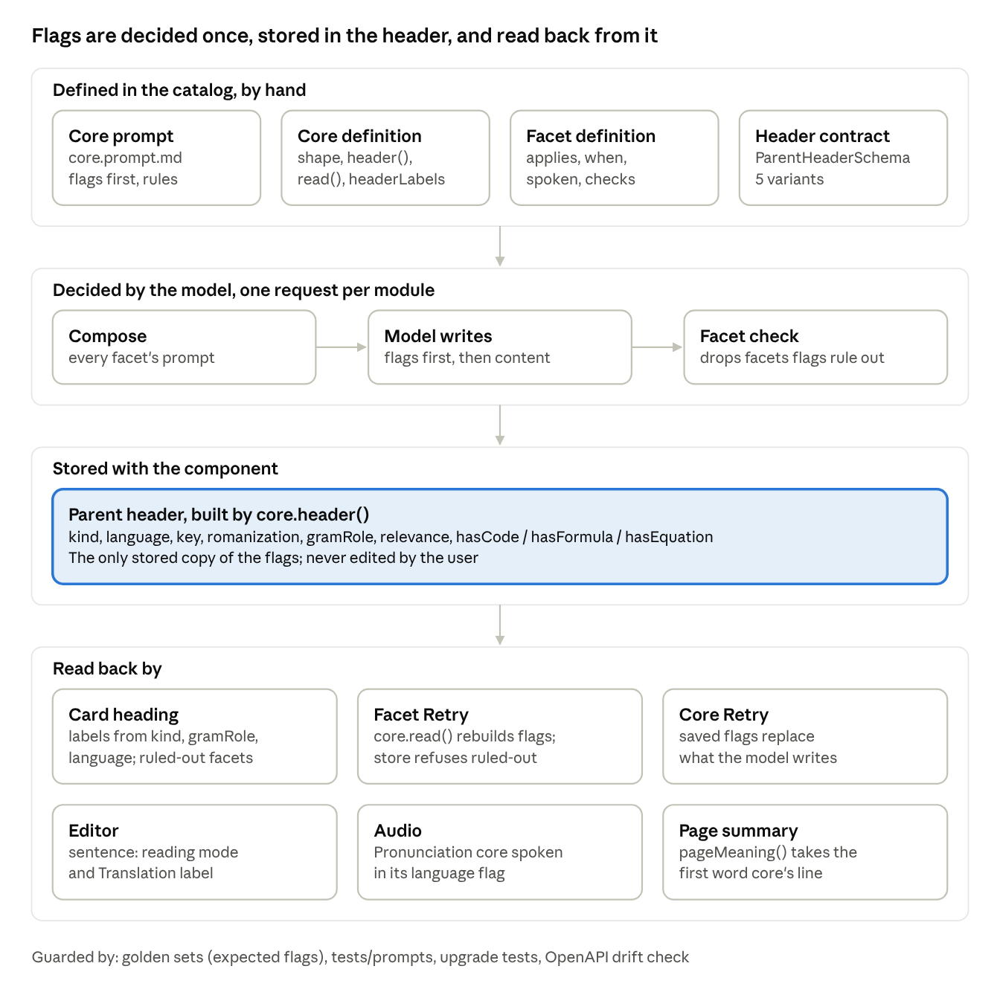

# Vocabularium headers and flags

Nov 9, 2026 · Yan · [Live document](https://claude.ai/artifact/CLPBmJzvFQdX2fd8uW7EAi)

## Purpose and scope

This document describes how headers and flags are defined in Vocabularium today, and everything that depends on them. It was read from `main` at `761bfbd` (release 0.16.4). It describes the current design only and proposes no changes.

Terms used below:

| Term | Meaning | Defined in |
| --- | --- | --- |
| Module header | The fixed, module-level fields of a module: `id`, `kind`, `instances`, `source`, `provider` | `catalog/<family>/<module>/module.ts`, typed by `catalog/define.ts` |
| Core | A content module's first facet, always present, with one shape and one prompt (D17) | `facets/core/facet.ts` |
| Flag | A classification the model writes first in the core's output: `kind`, `language`, `gramRole`, `relevance`, `hasCode`, `hasFormula`, `hasEquation` | the core's `shape` |
| Parent header | The structured top line stored beside the core's markdown, built from the flags by `core.header()` | `ParentHeaderSchema` in `packages/contracts/src/pages.ts` |
| Header labels | The words the card shows for some flag values, in the module's language | `core.headerLabels` |
| Facet header | A facet's own definition fields: `applies`, `when`, `spoken`, `checks` | `facets/<facet>/facet.ts` |

All paths in `catalog/` are under `packages/domain/src/`.

## Module header

Every module declares five fixed fields. They are written by hand in the catalog, never by a model, and they decide whether a module generates at all.

| Field | Values | What it controls |
| --- | --- | --- |
| `kind` | `input`, `content` | An input module holds text (no core, no facets). A content module has a core and facets and is generated. |
| `instances` | `first-once`, `at-most-one`, `many` | How many of this module a deck or page may hold. The main key is first and exactly once. |
| `source` | `captured`, `user`, `generated` | Where the content comes from. Every content module today is `generated`. |
| `provider` | `text`, `speech` (content only) | Which provider kind writes it. Every module today is `text`; spoken audio comes afterwards from the speech provider (D24). |
| `facets` | the module's facets after its core, in display order | Which facets exist and their order. Each module owns its facets (D25). |

Current modules:

| Module | Family | `kind` | `instances` | `source` | Header kind it writes |
| --- | --- | --- | --- | --- | --- |
| Main key | — | input | first-once | captured | — |
| Context | Notes | input | at-most-one | captured | — |
| Text | Notes | input | many | user | — |
| German | Languages | content | many | generated | `word` / `sentence` |
| Chinese | Languages | content | many | generated | `word` / `sentence` |
| English | Languages | content | many | generated | `word` / `sentence` |
| Computer Science | Expertise | content | many | generated | `expertise` |
| Mathematics | Expertise | content | many | generated | `expertise` |
| Chemistry | Expertise | content | many | generated | `expertise` |
| Pronunciation | Sound | content | at-most-one | generated | `pronunciation` |
| Traditional Haiku | Creativity | content | many | generated | `creativity` |
| Modern Haiku | Creativity | content | many | generated | `creativity` |
| Joke | Creativity | content | many | generated | `creativity` |

`source` already has the shape a dictionary path would need. Today it is set per module, not per facet, and no value means "looked up".

## Core flags and the parent header

There are seven flags. The model writes them first in the core, in the same request as the content (D17). Each core then turns them into a parent header with `core.header()`. The header has five variants, one per family.

### Flags

| Flag | Modules | Values | How the prompt decides it | In the header | Shown on the card |
| --- | --- | --- | --- | --- | --- |
| `kind` | German, Chinese, both English modules | `word`, `sentence` | From meaning and syntax; punctuation alone does not make a sentence | Always | As a label in the module's language (Wort / Satz, 词语 / 句子, Word / Sentence), only once `language` is filled |
| `language` (Languages) | German, Chinese, both English modules | Free text: the selection's language named in the module's language, such as "Chinesisch" | The one language the selection is in | Always; blank on a hand-written card until a Retry | As written |
| `language` (Pronunciation) | Pronunciation | ISO 639-1 codes the speech model speaks (80 codes), or `other` | From spelling, words and script; the Context breaks ties | Always; blank until generated | As the language's name |
| `language` (Creativity) | Traditional Haiku, Modern Haiku, Joke | Free text, an ISO 639-1 code or `other`, at most 8 characters | Same as Pronunciation, without the fixed list | Always; blank until generated | As the language's name |
| `gramRole` | German only | Free text the prompt asks to be an English lowercase part of speech | The part of speech of the "grammar word": the key when it is German, otherwise the German word for its first meaning | Only for a word | Through `headerLabels.gramRole` (noun → Nomen …), or the raw value when unmapped |
| `relevance` | Computer Science, Mathematics, Chemistry | `subject`, `neighbouring`, `unrelated` | Is the selection a concept of the subject, a term of a nearby field, or neither; the Context only picks the meaning | Always; `subject` on a hand-written card | Not shown |
| `hasCode` / `hasFormula` / `hasEquation` | Computer Science / Mathematics / Chemistry | `yes`, `no`, optional | Only when `relevance` is `subject`: does the standard definition have code, a formula, an equation | Only when `relevance` is `subject` | Not shown |

Two header fields are not flags, but travel with them:

- `key`: the selection, in every header.
- `romanization`: optional, Languages only. The model writes it "only when useful". The card shows it as the pronunciation line under the key.

`contextual` (the meaning in this Context, D29) and `meanings` are core text, not flags. They are stored in the core's markdown, not in the header.

### Header variants

The stored header is a union in `ParentHeaderSchema` (`packages/contracts/src/pages.ts`). Extra fields are refused.

| Header `kind` | Fields | Written by |
| --- | --- | --- |
| `word` | `language`, `key`, `romanization`?, `gramRole`? | Languages modules |
| `sentence` | `language`, `key`, `romanization`? | Languages modules |
| `expertise` | `key`, `relevance`, `hasFormula`?, `hasCode`?, `hasEquation`? | Expertise modules |
| `pronunciation` | `language` (≤ 8 characters), `key` | Pronunciation |
| `creativity` | `language` (≤ 8 characters), `key` | Creativity modules |

The header doubles as the stored form of the flags. A facet's own Retry and the core's Retry read the flags back from it with `core.read()`; nothing else stores them. A parent's header is written by generation and never edited by the user.

## Facet header

A facet applies when two tests pass, both in `appliesTo()` (`packages/domain/src/parents.ts`): its `applies` list contains the key's kind, and its optional `when` returns true for the core. Only `kind`, `gramRole`, `language`, `relevance` and the three `has…` flags are read by any `when`.

| Field | What it is | Reads flags? |
| --- | --- | --- |
| `applies` | `word_phrase`, `sentence` or both | `kind` (an Expertise core has no `kind` and counts as a word) |
| `when` | An optional test on the written core | Yes, see the table below |
| `spoken` | A fixed language its lines are spoken in (`de`, `zh`, `en`) | No; fixed per facet |
| `checks` | Deterministic tests run by the golden sets and the gate, never for a user | Some read the core beside the facet |

### Facets with a `when`

| Module | Facet | Applies to | `when` |
| --- | --- | --- | --- |
| German | Article | word | `gramRole` = noun |
| German | Conjugation | word | `gramRole` = verb |
| German | Declension | word | `gramRole` = noun or adjective |
| German | Comparison | word | `gramRole` = adjective |
| German | Case | word | `gramRole` = preposition |
| German | Grammar Teacher | word, sentence | `language` is "deutsch" |
| Chinese | Grammar Teacher | word, sentence | `language` is 中文, 汉语 or 普通话 |
| English | Grammar Teacher | word, sentence | `language` is english, british english or american english |
| Computer Science | Code | word, sentence | `relevance` = subject and `hasCode` = yes |
| Mathematics | Formula | word, sentence | `relevance` = subject and `hasFormula` = yes |
| Chemistry | Equation | word, sentence | `relevance` = subject and `hasEquation` = yes |

### Facets with no `when`

These depend on `kind` alone:

- **Word or sentence:** Examples, Pronunciation, Simple Translation (every Languages module), Pinyin (Chinese).
- **Word only:** Synonyms and Antonyms (German, both English modules), Etymology (every Languages module).

Pronunciation, the Creativity modules and their cores have no facets. The Pronunciation core is spoken in the language its `language` flag names, and not at all for `other` (`core.spoken`).

### Why a facet is ruled out

`ruledOut()` gives one of four reasons. The card uses it only to disable the facet's Retry, and the store refuses that Retry; the reason itself is not shown as text.

| Reason | When |
| --- | --- |
| `sentence` | A word-only facet on a sentence |
| `role` | A Languages `when` failed (wrong part of speech, or a key not in the module's own language) |
| `subject` | An Expertise card whose `relevance` is not `subject` |
| `none` | An Expertise card on its subject whose `has…` flag is `no` |

Grammar Teacher's language test reports `role`, the same reason as a part-of-speech mismatch.

## Lifecycle of a flag

Flags are decided once, by the model, inside the card's single request. After that they are only read back, never re-decided, except by a whole-card Retry.

### First generation (one request per module)

1. **Compose** (`composer/compose.ts`). The request holds the core's prompt, which lists the flags first, then a prompt for every facet the instance has. Facets are not filtered yet, because the flags are not known; each facet's prompt says in words when it applies. The schema joins the core's shape and every facet's shape.
2. **Generate** (`src/server/provider.mjs`, `opencode.mjs`). The model writes one JSON: the core with its flags first, then the facets.
3. **Validate** (`generateComponent` in `domain/modules.ts`). Fixes the known slip of facets written inside the core (Q50), removes blank optional fields, and checks every part against its shape.
4. **Facet check.** `facetsFor()` keeps only the facets that apply to the written core. A dropped facet emits `generation.facet_mismatch` (severity warn, no text). The golden sets count these.
5. **Format** (`domain/content.ts`). `core.header()` builds the header from the flags, keeping only what that variant allows (a `has…` flag only on a subject card). The core and facets become markdown, with the main key highlighted.
6. **Store** (`src/core/store-generation.mjs`). The content is staged, then published into the component as `{ type: 'parent', header, core, facets }`. An edit that changes the header is refused: "The module's top line can not be changed" (`store-pages.mjs`).

### Reading the flags back

7. **Render** (`domain/render.ts`). The heading shows `language`, `key`, `romanization` and labels for `kind` and `gramRole` from `headerLabels`. Expertise shows no labels; Pronunciation and Creativity show the language's name. `ruledOutOf()` marks the facets the flags rule out. A `sentence` switches the core to reading mode and its label to "Translation".
8. **Audio** (`domain/spoken.ts`). The Pronunciation core is spoken in its `language` flag's language. Spoken facets use their fixed language, whatever the flags say.
9. **Page summary** (`domain/page-modules.ts`). `pageMeaning()` shows the first line of the first `word` core, or else of the first `sentence` core, chosen by the header's `kind`.

### Retry and hand-written cards

| Path | What happens to the flags |
| --- | --- |
| A facet's own Retry | `core.read()` rebuilds the core, flags included, from the header and core markdown. The store refuses up front if the flags rule the facet out. The core goes to the model as input; only that facet is written. |
| The core's Retry (D28) | The saved core goes as `previous`. Whatever flags the model writes are replaced by the saved ones, so the header and every facet stay in step. Only the core's text changes. |
| A card's Retry (D28) | Starts over as a first attempt. The flags may change, and the whole card follows them. |
| A hand-written card | `blankContent()` writes a placeholder header: Languages a `word` with a blank `language`; Expertise `relevance: subject`; Pronunciation and Creativity a blank `language`. A Retry fills it. |

## Dependency map

The flags pass through one point: the stored header. Generation writes it once; every later reader rebuilds the flags from it.

| Area | File | Role |
| --- | --- | --- |
| Catalog types | `packages/domain/src/catalog/define.ts` | Module, core and facet fields; `Source`, `HeaderLabels`, `when` |
| Catalog | `catalog/<family>/<module>/facets/core/` | Each core's shape, `header()`, `read()`, `headerLabels`, `core.prompt.md` |
| Catalog | `catalog/<family>/<module>/facets/<facet>/facet.ts` | `applies`, `when`, `spoken`, `checks` |
| Contract | `packages/contracts/src/pages.ts` | `ParentHeaderSchema`, stored in `ParentBlockSchema` |
| Applicability | `packages/domain/src/parents.ts` | `appliesTo`, `facetsFor`, `ruledOut` |
| Generation | `packages/domain/src/composer/compose.ts`, `modules.ts` | Request, facet check, facet and core Retry |
| Content | `packages/domain/src/content.ts` | Header on format, validation, `blankContent` |
| Render | `packages/domain/src/render.ts`, `spoken.ts`, `page-modules.ts` | Heading labels, ruled-out map, audio language, page meaning |
| Server | `src/server/generation.mjs`, `src/core/store-generation.mjs`, `store-pages.mjs` | Mismatch event, refusing a ruled-out Retry, refusing header edits |
| Extension | `extension/card-content.tsx`, `live-editor.tsx`, `page-view.tsx` | Retry disabled, reading mode, core label |
| Tests | `tests/golden/*.json`, `tests/parents.test.mjs`, `tests/content.test.mjs`, `tests/upgrade.test.mjs` | Expected flags, applicability, header shape, upgrades |

## Constraints and couplings

Any redesign of headers and flags touches stored data, the API contract and the prompts at once. These are the rules it must keep, and the couplings in today's design that a redesign would meet.

### Invariants that apply

- **Stored data.** The header is stored inside every generated component. Changing its shape needs a new migration and an upgrade path that keeps existing decks and pages (`tests/upgrade.test.mjs`); applied migrations never change.
- **API contract.** `ParentHeaderSchema` is part of the API, so a change regenerates `docs/api/openapi.json`, and CI fails on drift.
- **Prompts.** A flag's wording lives in each `core.prompt.md`. Any change shows in `tests/prompts/*.txt` and must be measured against the golden sets.
- **Golden sets.** `tests/golden/*.json` state the expected `kind`, `gramRole` and `relevance` per input, checked automatically.
- **Header is generation-owned.** The user never edits a parent's header; the store refuses it.
- **Interface text.** Header labels live in each module's folder, not in code.

### Couplings in the current design

1. **Flags and content come from one request.** Nothing can be routed before generation. Every facet's prompt is sent, including those the flags will rule out, and their output is dropped afterwards.
2. **The header is both the display and the only store of the flags.** The core's Retry treats "the fields the header shows" as the flags to keep. A flag left out of the header would be neither stored nor preserved.
3. **`gramRole` can depend on a translation.** For a non-German key it describes the German word for the first meaning, which only exists once the model has written that meaning.
4. **`language` means three things.** A localised name in Languages ("Chinesisch"), a code from a fixed list in Pronunciation, a free code in Creativity. Grammar Teacher matches the localised name against hard-coded lists ("deutsch"; 中文, 汉语, 普通话; english …).
5. **`gramRole` is free text.** It is matched in lower case, mapped to a label when known, and shown raw when not. Only German has it.
6. **Shared flags are decided per module.** A card with German and Chinese modules decides `kind` and `language` twice, in two requests, and the two can disagree.
7. **Hidden flags still decide visible facets.** `relevance` and the `has…` flags are never shown, but they decide whether Code, Formula or Equation appear. A hand-written Expertise card defaults to `subject`.
8. **Reasons are coarse.** `role` covers both a part-of-speech mismatch and a key in another language, and no reason is shown to the user.
9. **`source` is per module.** It exists in the module header, but every content module is `generated`, and there is no value for content that is looked up rather than written.
